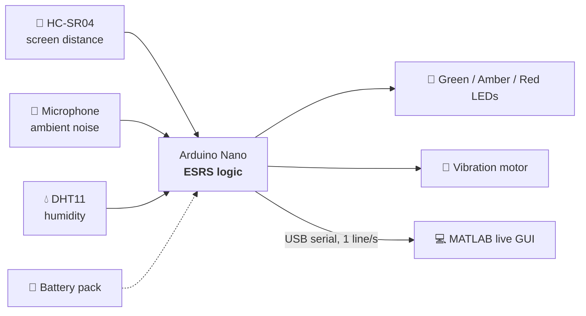
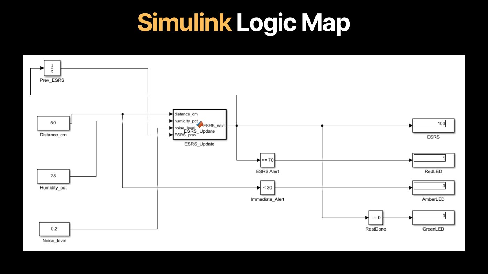
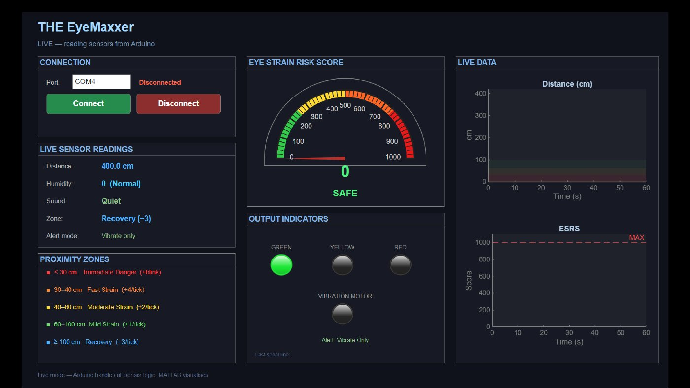

<div align="center">


# 👁️ EyeMaxxer

**An Arduino-powered, MATLAB-integrated clip-on device that fights digital eye strain.**

🥈 **2nd Place** &nbsp;·&nbsp; 🏆 **MATLAB Integration Award**

*MechSoc Imperial College London × Cambridge University Engineering Society (CUES) Make-a-thon on Student Wellbeing*


[](https://github.com/KooCeL/EyeMaxxer/actions/workflows/ci.yml)

🔗 [Project link](https://lnkd.in/daBxs7n5) &nbsp;·&nbsp; 📑 [Presentation slides (PDF)](docs/EyeMaxxer_presentation.pdf)

</div>

---

> 📅 **March 2026.** Built over one weekend in Cambridge, about 8 months before this
> repository was curated (November 2026), by a team made up entirely of first-year students.

## The problem

A study at Imam Abdulrahman University found that **68.53 % of students
had symptoms of digital eye strain (DES)**: 43.2 % mild and 11 % severe
(AlQarni et al., 2023). The two big drivers are **prolonged screen time** and
**close viewing distance**, and students rarely notice either until their eyes
already hurt.

## The solution

EyeMaxxer clips onto the top of a laptop and keeps an eye on *how* you use your screen.

| | |
|---|---|
|  |  |

- 📏 **A laptop-mounted ultrasonic sensor** measures your distance from the screen continuously.
- 🧮 **The Eye Strain Risk Score (ESRS)** goes up at a rate set by your proximity zone,
  and comes back down when you step away (≥ 100 cm).
- 🌫️ **It's context-aware:** **low humidity** (× 1.30) and **ambient noise** (× 1.20)
  speed up strain build-up whenever you sit closer than 60 cm.
- 🚦 **Green / amber / red LEDs** show both the *immediate* danger (sitting closer than
  **30 cm**) and the strain *accumulated over time*. A vibration motor can buzz as well.
- 📊 **A live MATLAB GUI** shows the real-time ESRS, screen distance and LED status.
- 🔋 **It works fully offline** on a battery pack, so it's portable for everyday use.



## The Eye Strain Risk Score

The ESRS exists in two versions. Both use the same structure: a proximity-zone rate,
dry/noisy multipliers below 60 cm, and clamping.

**1. The design model** (Simulink + MATLAB scenario testing) uses realistic time scales:
**0–100**, with rates in points per minute.

```matlab
deltaPerMin = rate(distance zone);
if distance_cm < 60
    if humidity_pct < 40,  deltaPerMin = deltaPerMin * 1.30; end   % dry
    if noise_level >= 0.6, deltaPerMin = deltaPerMin * 1.20; end   % noisy
end
ESRS = clamp(ESRS + deltaPerMin * dt/60, 0, 100);
```

**2. The live hardware demo** (Arduino + GUI) uses a faster **0–1000** scale that changes
every 1-second tick, so you can see it react within a minute or two.

| Distance | Zone | Model (ESRS/min, 0–100) | Live demo (per tick, 0–1000) |
|---|---|---:|---:|
| < 30 cm | 🔴 Immediate danger | +15.0 | +6 and blink |
| 30–40 cm | 🟠 Fast strain | +4.5 | +4 |
| 40–60 cm | 🟡 Moderate strain | +2.0 | +2 |
| 60–100 cm | 🟢 Mild strain | +0.1 | +1 |
| > 100 cm | 🔵 Recovery | −6.0 | −3 |

| LEDs | Design model (Simulink) | Live demo (Arduino) |
|---|---|---|
| 🟢 Green | ESRS = 0 (fully rested) | ESRS < 300 (safe) |
| 🟠 Amber | blinks when < 30 cm | 300 ≤ ESRS < 700 (warning) |
| 🔴 Red | blinks when ESRS ≥ 70 | ESRS ≥ 700 (take a break) · **blinks immediately when < 30 cm** |

In the model at 35 cm, the red alert comes on after **20.4 min** in a humid room but
after **16.9 min** in a dry one. → Full details and all five scenarios are in
[`docs/esrs-algorithm.md`](docs/esrs-algorithm.md).

## MATLAB integration 🏆

MATLAB integration was done in three stages, and it won the MATLAB Integration Award:

### 1️⃣ Embedded control logic in Simulink

The ESRS logic was designed as a MATLAB Function block with a Unit Delay feedback
loop, plus Compare blocks for the three LEDs, targeting the Arduino Nano.
→ [`simulink/`](simulink/README.md)



### 2️⃣ Scenario testing in MATLAB

[`matlab/eye_strain_sim.m`](matlab/eye_strain_sim.m) runs five scenarios to check
the behaviour before trusting the hardware: the danger zone, fast build-up in dry
vs humid air, a noisy environment, and recovery during a break. Each scenario
produces a polygraph-style figure of stacked strip charts: distance, humidity,
noise, ESRS and the LED on/off signals over time.
[`matlab/graph.fig`](matlab/graph.fig) is the saved figure for **Scenario 5 (recovery above 100 cm)**:


### 3️⃣ Live graphical UI

[`matlab/EyeMaxxerGUI.m`](matlab/EyeMaxxerGUI.m), "THE EyeMaxxer", shows:
- the connection controls
- live sensor readings and the proximity-zone legend
- a 0–1000 ESRS gauge
- the green/amber/red LED and vibration-motor indicators
- 60 s of live distance and ESRS history



The plan was to demo the GUI with simulated data. The team pushed further and got
**complete real-time hardware integration** working: the Arduino handles all the
sensor logic and MATLAB visualises it live over serial.

## Repository layout

```
EyeMaxxer/
├── simulink/
│   └── simulink_eyestrain.slx   original Simulink model (ESRS_Update + LED logic)
├── matlab/
│   ├── eye_strain_sim.m         original scenario testing script (5 scenarios)
│   ├── graph.fig                original figure: Scenario 5 strip charts
│   ├── esrsParams.m / esrsStep.m    design-model ESRS as reusable functions
│   ├── runScenarioTests.m       automated regression check of the 5 scenarios
│   └── EyeMaxxerGUI.m           "THE EyeMaxxer" live GUI (rebuilt)
├── firmware/EyeMaxxer/          Arduino sketch for the live device (rebuilt)
│   ├── EyeMaxxer.ino            sensors, LEDs, vibration motor, serial output
│   ├── esrs.h                   live ESRS engine (0–1000, per tick)
│   └── config.h                 pins, zones, increments, thresholds
├── tests/test_esrs.cpp          unit tests for the live ESRS engine
└── docs/                        slides (PDF), hardware, wiring, algorithm
```

**What's original and what's rebuilt:** the Simulink model, `eye_strain_sim.m`,
`graph.fig` and the slides are the original make-a-thon files. The original Arduino
sketch and GUI source were lost, so `firmware/` and `EyeMaxxerGUI.m` were rebuilt
from the GUI shown in the presentation. They use the same zones, increments,
0–1000 scale, LEDs, vibration motor and panel layout.

## Getting started

### Hardware

Arduino Nano (or Uno), an HC-SR04 ultrasonic sensor, green/amber/red LEDs with 220 Ω
resistors, and optionally a DHT11, a microphone module and a small vibration motor.
→ [`docs/hardware.md`](docs/hardware.md)

| Part | Pin | | Part | Pin |
|---|---|---|---|---|
| HC-SR04 TRIG / ECHO | D9 / D10 | | Green LED | D3 |
| DHT11 data *(optional)* | D2 | | Amber LED | D5 |
| Microphone AO *(optional)* | A0 | | Red LED | D6 |
| Vibration motor *(optional, via transistor)* | D8 | | | |

### Flash the firmware

1. Open `firmware/EyeMaxxer/EyeMaxxer.ino` in the Arduino IDE.
2. In the Library Manager, install **DHT sensor library** (Adafruit) and **Adafruit Unified Sensor**.
   No DHT11 fitted? Set `USE_DHT 0` in `config.h` and skip the libraries.
3. Select **Arduino Nano** (or **Uno**) and upload. On power-up the LEDs light green → amber → red as a self-test.

Or from the command line:

```bash
arduino-cli lib install "DHT sensor library" "Adafruit Unified Sensor"
```

```bash
arduino-cli compile --upload -p COM4 --fqbn arduino:avr:nano firmware/EyeMaxxer
```

### Run the MATLAB side

```matlab
cd matlab
EyeMaxxerGUI                  % live GUI: enter the port (e.g. COM4), press Connect
EyeMaxxerGUI("COM4")          % ...or connect straight away
EyeMaxxerGUI("demo")          % no hardware: scripted session through the same GUI
eye_strain_sim                % original scenario testing (5 strip-chart figures)
runScenarioTests              % automated model checks (also runs in GNU Octave)
```

To test the firmware logic on a PC:

```bash
g++ -std=c++11 -I firmware/EyeMaxxer tests/test_esrs.cpp -o test_esrs && ./test_esrs
```

<details>
<summary>Serial protocol (9600 baud, one line per second)</summary>

```
DIST:45.2,HUM:38,SOUND:0,ZONE:2,INC:2.6,ESRS:512.4,LED:1,BLINK:0,VIB:0,MODE:0
```

| Key | Meaning |
|---|---|
| `DIST` | distance in cm (400 = no echo / away) |
| `HUM` | humidity % (0 until the DHT11 responds) |
| `SOUND` | 1 = loud, 0 = quiet |
| `ZONE` | 0 < 30 cm · 1 30–40 · 2 40–60 · 3 60–100 · 4 ≥ 100 (recovery) |
| `INC` | ESRS change this tick, after multipliers |
| `ESRS` | score, 0–1000 |
| `LED` | 0 green · 1 amber · 2 red |
| `BLINK` | 1 = immediate danger (< 30 cm), red LED blinking |
| `VIB` | 1 = vibration motor pulsing |
| `MODE` | alert mode: 0 LED + vibrate · 1 LED only · 2 vibrate only |

Commands: `r` resets the ESRS, `m` cycles the alert mode, `0`/`1`/`2` set it directly.
</details>

## Team

Built by a team of first-year students:

- **Maxell Fanson Suharsono** ([@KooCeL](https://github.com/KooCeL))
- [Martin Stoynev](https://www.linkedin.com/in/martinstoynev/)
- [Alim Aswani](https://www.linkedin.com/in/alim-aswani-843aa527b/)
- [Jeremy Kek](https://www.linkedin.com/in/jeremykek/)
- [Tiance Zhu](https://www.linkedin.com/in/tiance-z-548b4a3a1/)

## Acknowledgements

Huge thanks to [MechSoc – Imperial College London](https://www.linkedin.com/company/mechsoc-icl/)
and the [Cambridge University Engineering Society (CUES)](https://www.linkedin.com/company/cuengsoc/)
for hosting the make-a-thon, to James from MathWorks for the MATLAB support, and especially to
MechSoc president [Sanan Shankar](https://www.linkedin.com/in/sanan-shankar/) and
[Joseph Nestor](https://www.linkedin.com/in/joseph-nestor/) for organising such an inspiring event.

## What's next

- 👀 **Eye-tracking integration** to make EyeMaxxer smarter and more personalised.
- 🔗 Fully integrate the UI with the product, plus a personal **EyeScore**.
- 📱 Support **other devices**: tablets and books.
- 🏢 Expand to **other markets**: office work, gaming, and cycling (blind-spot and distance warnings).

---

<sub>The ESRS rates and thresholds were chosen for a working prototype under make-a-thon time pressure. They are not clinically validated. If you have persistent eye discomfort, see an optometrist.</sub>
