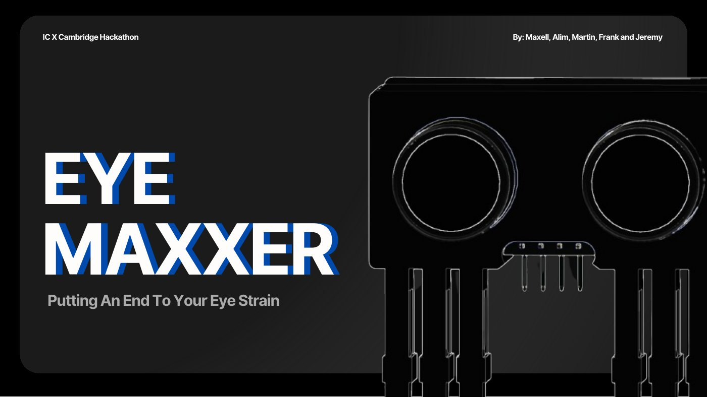
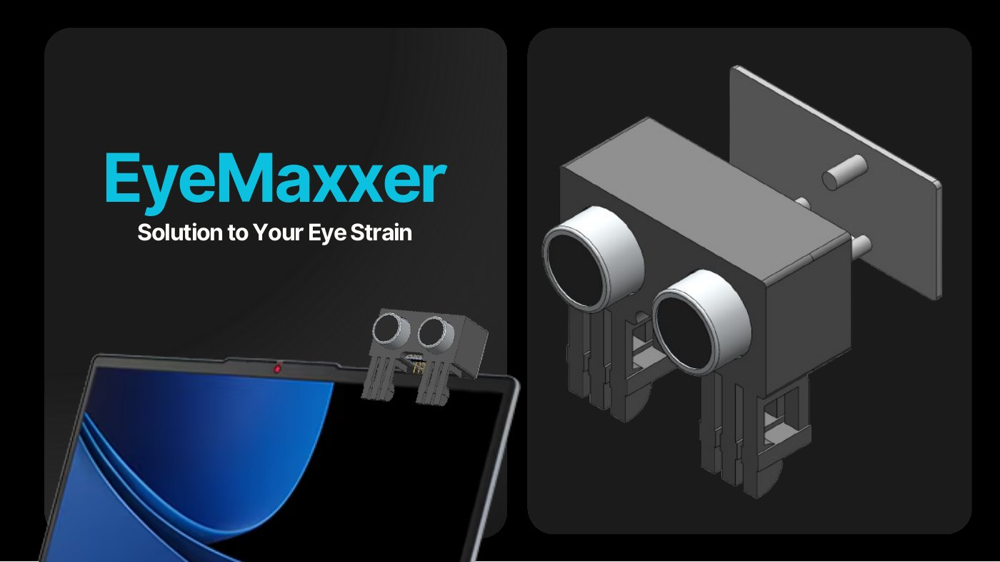
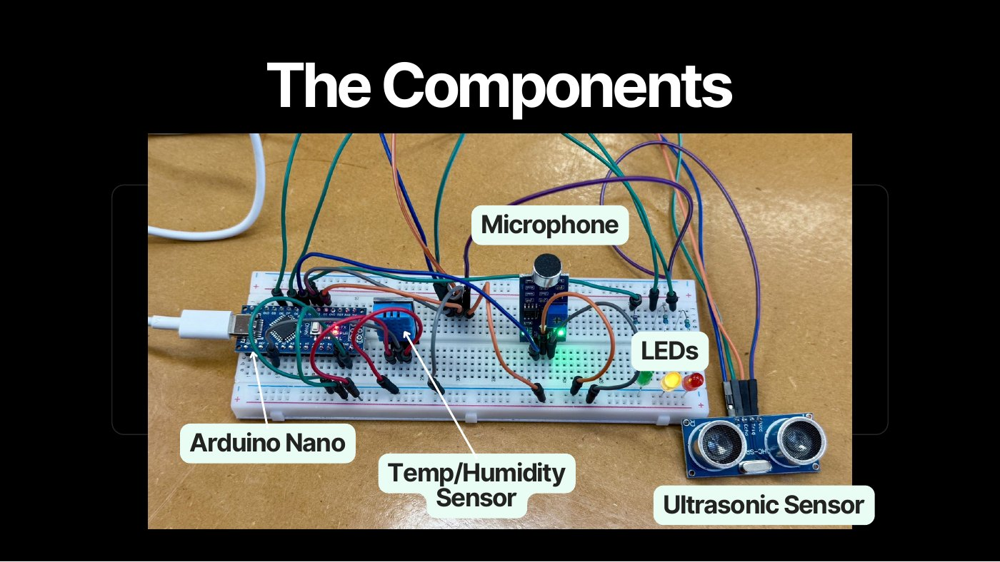
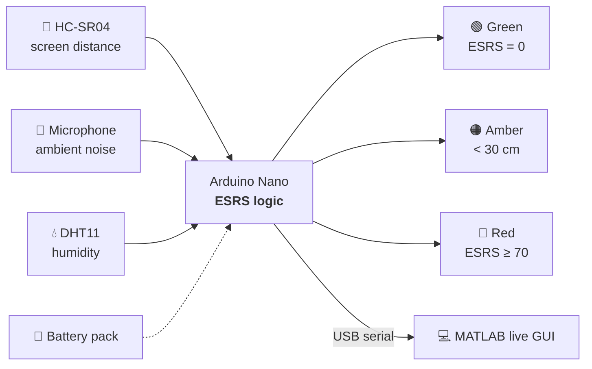
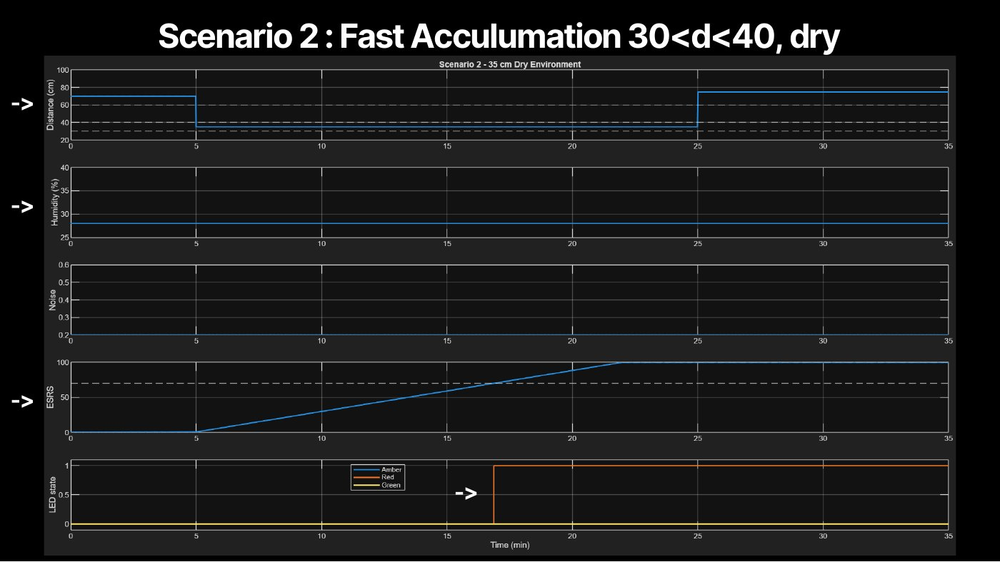

<div align="center">



# 👁️ EyeMaxxer

**An Arduino-powered, MATLAB-integrated clip-on device that fights digital eye strain.**

🥈 **2nd Place** &nbsp;·&nbsp; 🏆 **MATLAB Integration Award**

*MechSoc Imperial College London × Cambridge University Engineering Society (CUES) Make-a-thon on Student Wellbeing*


[](https://github.com/KooCeL/EyeMaxxer/actions/workflows/ci.yml)

🔗 [Project link](https://lnkd.in/daBxs7n5) &nbsp;·&nbsp; 📑 [Presentation slides (PDF)](docs/EyeMaxxer_presentation.pdf)

</div>

---

> 📅 Built over one weekend in Cambridge, **about 7 months before this repository
> was curated (November 2026)**, by a team made up entirely of first-year students.

## The problem

A study at Imam Abdulrahman University found that **68.53 % of students
had symptoms of digital eye strain (DES)**: 43.2 % mild and 11 % severe
(AlQarni et al., 2023). The two big drivers are **prolonged screen time** and
**close viewing distance**, and students rarely notice either until their eyes
already hurt.

## The solution

EyeMaxxer clips onto the top of a laptop and keeps an eye on *how* you use your screen.

| | |
|---|---|
|  |  |

- 📏 **A laptop-mounted ultrasonic sensor** measures your distance from the screen continuously.
- 🧮 **The Eye Strain Risk Score (ESRS)** goes up at a rate set by how close you sit,
  and comes back down when you step away (> 100 cm).
- 🌫️ **It's context-aware:** **low humidity** (× 1.30) and **ambient noise** (× 1.20) speed
  up strain build-up whenever you sit closer than 60 cm.
- 🚦 **Three LEDs** warn on two time scales:
  - 🟠 **amber blinks immediately** if you sit closer than **30 cm**,
  - 🔴 **red blinks** once the accumulated ESRS reaches **70**,
  - 🟢 **green stays on** while you're fully rested (ESRS = 0).
- 📊 **A live MATLAB GUI** shows the real-time ESRS, screen distance and LED status.
- 🔋 **It works fully offline** on a battery pack, so it's portable for everyday use.



## The Eye Strain Risk Score

```matlab
deltaPerMin = rate(distance zone);
if distance_cm < 60
    if humidity_pct < 40,  deltaPerMin = deltaPerMin * 1.30; end   % dry
    if noise_level >= 0.6, deltaPerMin = deltaPerMin * 1.20; end   % noisy
end
ESRS = clamp(ESRS + deltaPerMin * dt/60, 0, 100);
```

| Distance | Zone | ESRS / min |
|---|---|---:|
| < 30 cm | 🔴 Immediate danger (amber LED blinks) | +15.0 |
| 30–40 cm | 🟠 Fast strain | +4.5 |
| 40–60 cm | 🟡 Moderate strain | +2.0 |
| 60–100 cm | 🟢 Mild strain | +0.1 |
| > 100 cm | 🔵 Recovery | −6.0 |

For example, at 35 cm the red LED comes on after **20.4 min** in a humid room but after
**16.9 min** in a dry one. → Full details and all five scenarios are in
[`docs/esrs-algorithm.md`](docs/esrs-algorithm.md).

## MATLAB integration 🏆

MATLAB integration was done in three stages, and it won the MATLAB Integration Award:

### 1️⃣ Embedded control logic in Simulink

The ESRS logic was designed as a MATLAB Function block with a Unit Delay feedback
loop, plus Compare blocks for the three LEDs, targeting the Arduino Nano.
→ [`simulink/`](simulink/README.md)


### 2️⃣ Scenario testing in MATLAB

[`matlab/eye_strain_sim.m`](matlab/eye_strain_sim.m) runs five scenarios to check
the behaviour before trusting the hardware: the danger zone, fast build-up in dry
vs humid air, a noisy environment, and recovery during a break.



### 3️⃣ Live graphical UI

A MATLAB GUI shows the real-time ESRS gauge, live distance and ESRS plots,
sensor readings, proximity zones and LED status.


The plan was to demo the GUI with simulated data. The team pushed further and got
**complete real-time hardware integration** working: the Arduino handles all the
sensor logic and MATLAB visualises it live over serial.

## Repository layout

```
EyeMaxxer/
├── simulink/
│   └── simulink_eyestrain.slx   original Simulink model (ESRS_Update + LED logic)
├── matlab/
│   ├── eye_strain_sim.m         original scenario testing script (5 scenarios)
│   ├── graph.fig                original MATLAB figure from the make-a-thon
│   ├── esrsParams.m / esrsStep.m    ESRS logic as reusable functions
│   ├── runScenarioTests.m       automated regression check of the 5 scenarios
│   └── EyeMaxxerDashboard.m     live GUI (Arduino serial, or simulated)
├── firmware/EyeMaxxer/          Arduino sketch (Nano / Uno)
│   ├── EyeMaxxer.ino            sensors, LEDs, serial telemetry
│   ├── esrs.h                   C++ port of ESRS_Update
│   └── config.h                 pin map + constants
├── tests/test_esrs.cpp          checks the firmware against the MATLAB scenario timings
└── docs/                        slides (PDF), hardware, wiring, algorithm
```

The Simulink model, `eye_strain_sim.m`, `graph.fig` and the slides are the original
make-a-thon files. The Arduino firmware, the GUI script and the tests were
rewritten and documented for this repository. They follow the original logic
exactly, and CI checks that the C++ firmware reproduces the MATLAB scenario timings.

## Getting started

### Hardware

Arduino Nano (or Uno), HC-SR04, DHT11, a microphone sound-sensor module, three LEDs
(green, amber, red) and 220 Ω resistors. → [`docs/hardware.md`](docs/hardware.md)

| Part | Pin | | Part | Pin |
|---|---|---|---|---|
| HC-SR04 TRIG / ECHO | D9 / D10 | | Green LED | D3 |
| DHT11 data | D2 | | Amber LED | D5 |
| Microphone AO | A0 | | Red LED | D6 |

### Flash the firmware

1. Open `firmware/EyeMaxxer/EyeMaxxer.ino` in the Arduino IDE.
2. In the Library Manager, install **DHT sensor library** (Adafruit) and **Adafruit Unified Sensor**.
3. Select **Arduino Nano** (or **Uno**) and upload. On power-up the three LEDs light in turn as a self-test.

Or from the command line:

```bash
arduino-cli lib install "DHT sensor library" "Adafruit Unified Sensor"
```

```bash
arduino-cli compile --upload -p COM4 --fqbn arduino:avr:nano firmware/EyeMaxxer
```

### Run the MATLAB side

```matlab
cd matlab
eye_strain_sim                % original scenario testing: 5 figures + LED timings
EyeMaxxerDashboard            % live GUI: enter the port, press Connect (or Simulate)
EyeMaxxerDashboard("COM4")    % ...or connect straight away
runScenarioTests              % automated checks (also runs in GNU Octave)
```

To test the firmware logic on a PC:

```bash
g++ -std=c++11 -I firmware/EyeMaxxer tests/test_esrs.cpp -o test_esrs && ./test_esrs
```

<details>
<summary>Serial protocol (9600 baud)</summary>

```
D,t_ms,distance_cm,humidity_pct,noise,temp_c,rate_per_min,esrs,zone,green,amber,red
D,183400,35.2,28.0,0.21,22.1,5.85,41.37,1,0,0,0
```

`zone`: 0 = < 30 cm · 1 = 30–40 · 2 = 40–60 · 3 = 60–100 · 4 = > 100 (recovery).
Send `r` to reset the score, `?` to reprint the header.
</details>

## Team

Built by a team of first-year students:

- **Maxell Fanson Suharsono** ([@KooCeL](https://github.com/KooCeL))
- [Martin Stoynev](https://www.linkedin.com/in/martinstoynev/)
- [Alim Aswani](https://www.linkedin.com/in/alim-aswani-843aa527b/)
- [Jeremy Kek](https://www.linkedin.com/in/jeremykek/)
- [Tiance Zhu](https://www.linkedin.com/in/tiance-z-548b4a3a1/)

## Acknowledgements

Huge thanks to [MechSoc – Imperial College London](https://www.linkedin.com/company/mechsoc-icl/)
and the [Cambridge University Engineering Society (CUES)](https://www.linkedin.com/company/cuengsoc/)
for hosting the make-a-thon, to James from MathWorks for the MATLAB support, and especially to
MechSoc president [Sanan Shankar](https://www.linkedin.com/in/sanan-shankar/) and
[Joseph Nestor](https://www.linkedin.com/in/joseph-nestor/) for organising such an inspiring event.

## What's next

- 👀 **Eye-tracking integration** to make EyeMaxxer smarter and more personalised.
- 🔗 Fully integrate the UI with the product, plus a personal **EyeScore**.
- 📱 Support **other devices**: tablets and books.
- 🏢 Expand to **other markets**: office work, gaming, and cycling (blind-spot and distance warnings).

---

<sub>The ESRS rates and thresholds were chosen for a working prototype under make-a-thon time pressure. They are not clinically validated. If you have persistent eye discomfort, see an optometrist.</sub>
