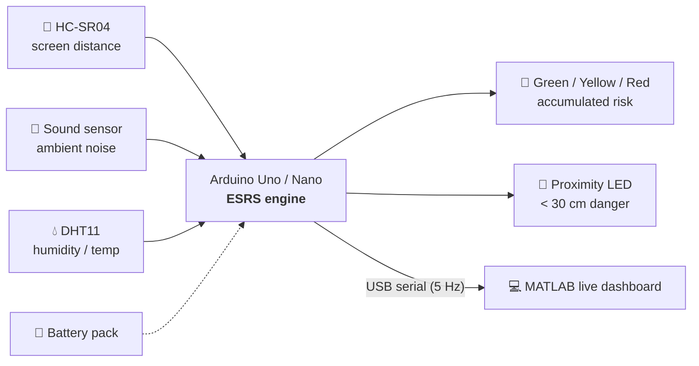
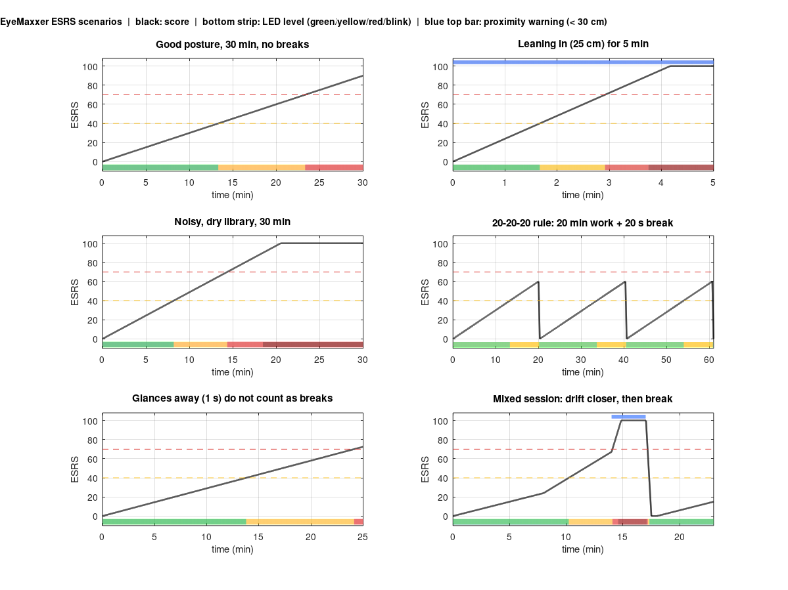

<div align="center">

# 👁️ EyeMaxxer

**An Arduino-powered, MATLAB-integrated system that fights digital eye strain.**

🥈 **2nd Place** &nbsp;·&nbsp; 🏆 **MATLAB Integration Award**

*MechSoc Imperial College London × Cambridge University Engineering Society Make-a-thon on Student Wellbeing*


[](https://github.com/KooCeL/EyeMaxxer/actions/workflows/ci.yml)

🔗 [Project link](https://lnkd.in/daBxs7n5)

</div>

---

> 📅 **April 2026.** Built over one weekend in Cambridge, about **7 months before
> this repository was curated (November 2026)**, by a team made up entirely of
> first-year students.

## The problem

Students spend hours a day in front of laptops, often hunched in close and
skipping breaks, in dry, noisy libraries. All of this adds up to **digital eye
strain**: tired, dry eyes, headaches and blurred vision. Most people only notice
it once it already hurts.

## What EyeMaxxer does

EyeMaxxer clips onto a laptop and gives you an early, glanceable warning
**before** strain builds up.

- 📏 **Measures your screen distance continuously** with a laptop-mounted ultrasonic sensor.
- 🧮 **Computes an Eye Strain Risk Score (ESRS)**, which rises with screen exposure and
  rises faster the closer you sit. It falls again when you step away for a real break.
- 🌫️ **Is context-aware.** Ambient **noise** and **low humidity** act as multipliers on
  the ESRS increment, so strain builds faster in a dry, noisy room.
- 🚦 **Warns you on two time scales:**
  - an *immediate* proximity LED when you sit closer than **30 cm**, and
  - a green → yellow → red (→ blinking) LED bar for the strain *accumulated over time*.
- 📊 **Streams live data to a MATLAB dashboard** showing the real-time ESRS, screen distance and LED status.
- 🔋 **Works fully offline** on a battery pack, so it's portable for everyday use.



## The Eye Strain Risk Score

Every 100 ms the score is updated:

```
ESRS += base_rate(distance zone) × noise_multiplier × humidity_multiplier × dt     (at the screen)
ESRS -= recovery_rate × dt                                                        (away > 2 s)
```

| Zone | Distance | Rate | | Condition | Multiplier |
|---|---|---:|---|---|---:|
| 🔴 Danger | < 30 cm | +0.40 /s | | Noise above threshold | × 1.25 |
| 🟠 Close | 30–50 cm | +0.12 /s | | Humidity < 40 % | × 1.30 |
| 🟢 OK | 50–120 cm | +0.05 /s | | | |
| 💤 Away | > 120 cm | −3.5 /s | | | |

| ESRS | 0–40 | 40–70 | 70–90 | 90–100 |
|---|---|---|---|---|
| **LED** | 🟢 low risk | 🟡 rising | 🔴 take a break | 🔴 blinking, overdue |

With these settings, a healthy posture reaches red in about **23 minutes**. A noisy, dry room
cuts that to about **14 minutes**, and leaning in under 30 cm gets there in about **3 minutes**.
A 20-second break after 20 minutes (the **20-20-20 rule**) resets the score.
→ Full details in [`docs/esrs-algorithm.md`](docs/esrs-algorithm.md).

## MATLAB integration (MATLAB Integration Award 🏆)

MATLAB integration was done in three stages:

1. **Embedded control logic in Simulink.** The sensing → ESRS → LED pipeline was
   designed in Simulink and deployed to an Arduino Nano.
   See [`simulink/`](simulink/README.md).
2. **Scenario testing in MATLAB.** The algorithm was validated against realistic study
   sessions (good posture, leaning in, a noisy dry library, 20-20-20 breaks, quick
   glances away) before trusting the hardware. See [`matlab/runScenarioTests.m`](matlab/runScenarioTests.m).
3. **Live graphical UI.** A MATLAB app shows the real-time ESRS gauge and trend,
   the screen distance, the environment readings and the LED status.
   See [`matlab/EyeMaxxerDashboard.m`](matlab/EyeMaxxerDashboard.m).

The plan was to demo the GUI with simulated data. The team pushed further and
got **complete real-time hardware integration** working: the dashboard is driven
live by the Arduino over serial.



## Repository layout

```
EyeMaxxer/
├── firmware/EyeMaxxer/      Arduino sketch (Uno / Nano)
│   ├── EyeMaxxer.ino        sensors, scheduler, LEDs, serial telemetry
│   ├── esrs.h               ESRS engine (pure C++, no Arduino deps)
│   └── config.h             pin map + all tuning constants
├── matlab/
│   ├── esrsParams.m         same constants as config.h
│   ├── esrsInit.m / esrsStep.m   ESRS model (Simulink MATLAB Function-ready)
│   ├── runScenarioTests.m   scenario testing + plots
│   └── EyeMaxxerDashboard.m live UI (serial or simulated)
├── simulink/                Simulink model notes
├── tests/test_esrs.cpp      host-side unit tests for the firmware ESRS engine
└── docs/                    hardware, wiring and algorithm docs
```

The code here is a cleaned-up, documented version of the prototype. The C++
firmware and the MATLAB model implement the same algorithm, and CI checks both.

## Getting started

### 1. Build the hardware

You'll need an Arduino Uno (or Nano), an HC-SR04, a DHT11, an analog sound sensor,
4 LEDs and a few resistors. The parts list and wiring are in [`docs/hardware.md`](docs/hardware.md).

| Part | Pin | | Part | Pin |
|---|---|---|---|---|
| HC-SR04 TRIG / ECHO | D9 / D10 | | Green / Yellow / Red LED | D3 / D5 / D6 |
| DHT11 data | D2 | | Proximity LED | D7 |
| Sound sensor AO | A0 | | | |

### 2. Flash the firmware

1. Open `firmware/EyeMaxxer/EyeMaxxer.ino` in the Arduino IDE.
2. In the Library Manager, install **DHT sensor library** (Adafruit) and **Adafruit Unified Sensor**.
3. Select **Arduino Uno** (or **Nano**) and upload.
4. On power-up the LEDs sweep once as a self-test. Open the Serial Monitor at **115200 baud** to see the telemetry.

Or from the command line:

```bash
arduino-cli lib install "DHT sensor library" "Adafruit Unified Sensor"
```

```bash
arduino-cli compile --fqbn arduino:avr:uno firmware/EyeMaxxer
```

```bash
arduino-cli upload -p /dev/ttyACM0 --fqbn arduino:avr:uno firmware/EyeMaxxer
```

### 3. Run the MATLAB dashboard

```matlab
cd matlab
EyeMaxxerDashboard            % simulated study session, no hardware needed
serialportlist("available")   % find your board
EyeMaxxerDashboard("COM5")    % live data from the Arduino (e.g. "/dev/ttyACM0" on Linux/macOS)
```

Requires MATLAB R2020a or newer. **Reset ESRS** sends `r` to the board.

### 4. Run the tests

```matlab
cd matlab
runScenarioTests              % MATLAB or GNU Octave
```

```bash
g++ -std=c++11 -Wall -Wextra -I firmware/EyeMaxxer tests/test_esrs.cpp -o test_esrs && ./test_esrs
```

### Serial protocol

The board prints a CSV line at 5 Hz, plus `#`-prefixed comment lines:

```
D,t_ms,distance_cm,noise,humidity_pct,temp_c,multiplier,esrs,zone,level,prox
D,183400,47.3,212,34.0,22.1,1.625,58.41,2,1,0
```

`zone`: 0 away · 1 danger · 2 close · 3 ok. `level`: 0 green · 1 yellow · 2 red · 3 red-blink.
Commands: `r` resets the score, `?` reprints the header.

## Team

Built by a team of first-year students:

- [KooCeL](https://github.com/KooCeL) (repository author)
- [Martin Stoynev](https://www.linkedin.com/in/martinstoynev/)
- [Alim Aswani](https://www.linkedin.com/in/alim-aswani-843aa527b/)
- [Jeremy Kek](https://www.linkedin.com/in/jeremykek/)
- [Tiance Zhu](https://www.linkedin.com/in/tiance-z-548b4a3a1/)

## Acknowledgements

Huge thanks to [MechSoc – Imperial College London](https://www.linkedin.com/company/mechsoc-icl/)
and the [Cambridge University Engineering Society (CUES)](https://www.linkedin.com/company/cuengsoc/)
for hosting the make-a-thon, to James from MathWorks for the MATLAB support, and especially to
MechSoc president [Sanan Shankar](https://www.linkedin.com/in/sanan-shankar/) and
[Joseph Nestor](https://www.linkedin.com/in/joseph-nestor/) for organising such an inspiring event.

## What's next

- 👀 **Eye-tracking integration** (e.g. webcam-based blink rate and gaze detection) to make
  EyeMaxxer smarter and more personalised.
- 🎛️ Per-user calibration of thresholds and multipliers.
- 📱 A wireless (BLE) version with a phone companion app.

---

<sub>The ESRS thresholds were tuned for a working prototype under hackathon time pressure. They are not clinically validated. If you have persistent eye discomfort, see an optometrist.</sub>
