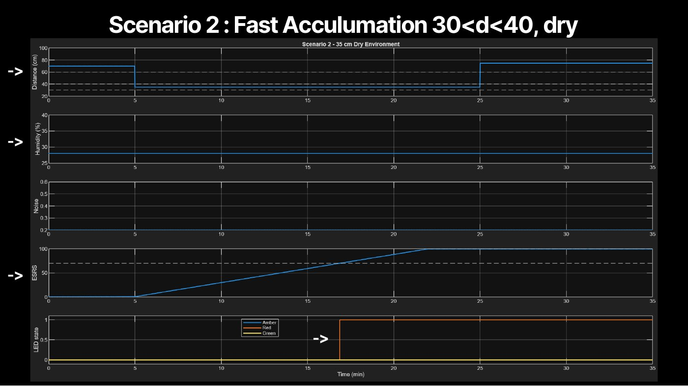
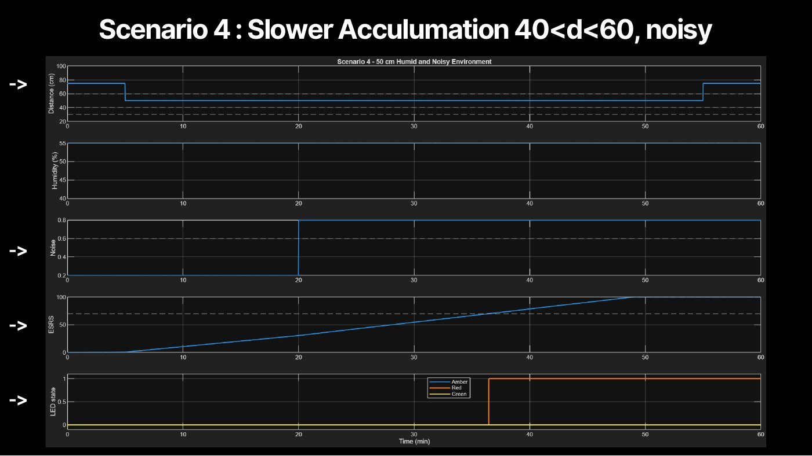
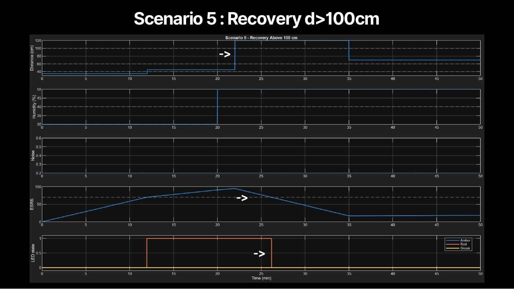

# Eye Strain Risk Score (ESRS)

The ESRS is a score from **0 (rested)** to **100 (maximum strain)**. It
accumulates while you sit at the screen and drains when you step away.

The logic was first written as the `ESRS_Update` MATLAB Function block in the
[Simulink model](../simulink/simulink_eyestrain.slx), then validated with the
[scenario script](../matlab/eye_strain_sim.m). The same rules run in three places:

| Implementation | Role |
|---|---|
| [`simulink/simulink_eyestrain.slx`](../simulink/simulink_eyestrain.slx) → `ESRS_Update` | Original embedded logic (Simulink, MATLAB Function block + Unit Delay) |
| [`matlab/eye_strain_sim.m`](../matlab/eye_strain_sim.m) | Original scenario testing (5 scenarios, plots) |
| [`matlab/esrsStep.m`](../matlab/esrsStep.m) | Reusable version used by the GUI simulation and the automated checks |
| [`firmware/EyeMaxxer/esrs.h`](../firmware/EyeMaxxer/esrs.h) | C++ port running on the Arduino |

## Update rule

Every time step `dt` (1 s in the model, 0.1 s on the Arduino):

```matlab
deltaPerMin = rate(distance zone)

if distance_cm < 60                 % environment only matters up close
    if humidity_pct < 40,  deltaPerMin = deltaPerMin * 1.30; end   % dry
    if noise_level >= 0.6, deltaPerMin = deltaPerMin * 1.20; end   % noisy
end

ESRS = clamp(ESRS + deltaPerMin * dt/60, 0, 100)
```

## Distance zones

| Distance | Zone | Rate (ESRS points / min) |
|----------|------|-------------------------:|
| < 30 cm | Immediate danger | +15.0 |
| 30–40 cm | Fast strain | +4.5 |
| 40–60 cm | Moderate strain | +2.0 |
| 60–100 cm | Mild strain | +0.1 |
| > 100 cm | Recovery (away from the screen) | −6.0 |

## Alerts

These match the Compare blocks in the Simulink model:

| LED | Condition | Simulink block | Behaviour |
|-----|-----------|----------------|-----------|
| 🟠 Amber | distance < 30 cm | `Immediate_Alert` | Blinks: immediate warning, whatever the score |
| 🔴 Red | ESRS ≥ 70 | `ESRS Alert` | Blinks: accumulated strain, take a break |
| 🟢 Green | ESRS = 0 | `RestDone` | Steady: fully rested |

## Scenario results

From [`eye_strain_sim.m`](../matlab/eye_strain_sim.m). The same timings are
checked automatically by `matlab/runScenarioTests.m` (MATLAB model) and
`tests/test_esrs.cpp` (Arduino C++ port):

| Scenario | Conditions | Result |
|----------|-----------|--------|
| 1 | 25 cm from minute 2 to 5 | Amber at **2.00 min**; ESRS ≈ 45, red never on |
| 2 | 35 cm, **dry** (28 %) | Red at **16.87 min** |
| 3 | 35 cm, humid (55 %) | Red at **20.43 min**, 3.5 min later than in dry air |
| 4 | 50 cm, noisy from minute 20 | Red at **36.45 min** |
| 5 | 35 → 45 cm, then > 100 cm break | Red at **11.95 min**, clears at **26.17 min** during the break |

| | |
|---|---|
|  |  |
|  |  |
|  | |

> The rates and thresholds were picked by the team for a convincing prototype
> under make-a-thon time pressure. They are not clinically validated.
