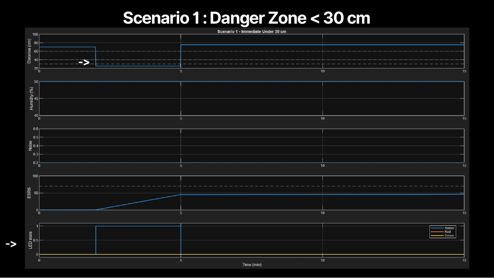
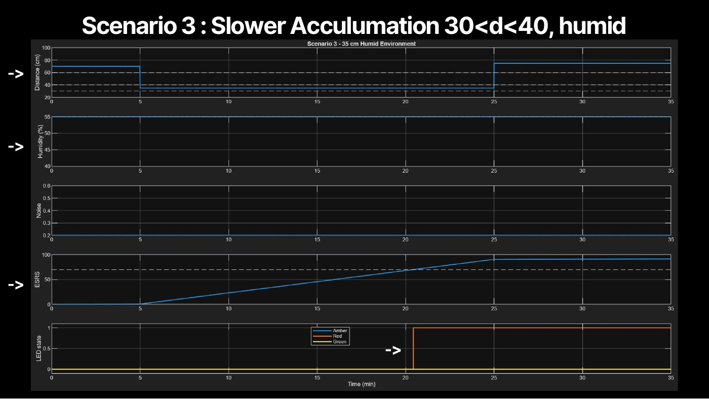

# Eye Strain Risk Score (ESRS)

The ESRS accumulates while you sit at the screen and drains when you step away.
It exists in two versions with the same structure:

- the **design model** (0–100, rates per minute), built in Simulink and tested
  with MATLAB scenarios, described first below, and
- the **live hardware version** (0–1000, increments per 1 s tick), which runs on
  the Arduino and drives the GUI. It is faster so it reacts visibly in a live
  demo. See [Live hardware version](#live-hardware-version).

The design model was first written as the `ESRS_Update` MATLAB Function block in the
[Simulink model](../simulink/simulink_eyestrain.slx), then validated with the
[scenario script](../matlab/eye_strain_sim.m):

| Implementation | Role |
|---|---|
| [`simulink/simulink_eyestrain.slx`](../simulink/simulink_eyestrain.slx) → `ESRS_Update` | Original embedded logic (Simulink, MATLAB Function block + Unit Delay) |
| [`matlab/eye_strain_sim.m`](../matlab/eye_strain_sim.m) | Original scenario testing (5 scenarios, plots) |
| [`matlab/esrsStep.m`](../matlab/esrsStep.m) + [`runScenarioTests.m`](../matlab/runScenarioTests.m) | Reusable version and automated regression checks |

## Update rule

Every time step `dt` (1 s in the model):

```matlab
deltaPerMin = rate(distance zone)

if distance_cm < 60                 % environment only matters up close
    if humidity_pct < 40,  deltaPerMin = deltaPerMin * 1.30; end   % dry
    if noise_level >= 0.6, deltaPerMin = deltaPerMin * 1.20; end   % noisy
end

ESRS = clamp(ESRS + deltaPerMin * dt/60, 0, 100)
```

## Distance zones

| Distance | Zone | Rate (ESRS points / min) |
|----------|------|-------------------------:|
| < 30 cm | Immediate danger | +15.0 |
| 30–40 cm | Fast strain | +4.5 |
| 40–60 cm | Moderate strain | +2.0 |
| 60–100 cm | Mild strain | +0.1 |
| > 100 cm | Recovery (away from the screen) | −6.0 |

## Alerts

These match the Compare blocks in the Simulink model:

| LED | Condition | Simulink block | Behaviour |
|-----|-----------|----------------|-----------|
| 🟠 Amber | distance < 30 cm | `Immediate_Alert` | Blinks: immediate warning, whatever the score |
| 🔴 Red | ESRS ≥ 70 | `ESRS Alert` | Blinks: accumulated strain, take a break |
| 🟢 Green | ESRS = 0 | `RestDone` | Steady: fully rested |

## Scenario results

From [`eye_strain_sim.m`](../matlab/eye_strain_sim.m). The same timings are
checked automatically by `matlab/runScenarioTests.m`. Each run draws a
polygraph-style figure of stacked strip charts (distance, humidity, noise,
ESRS, LED on/off). [`matlab/graph.fig`](../matlab/graph.fig) is the saved
Scenario 5 figure.

| Scenario | Conditions | Result |
|----------|-----------|--------|
| 1 | 25 cm from minute 2 to 5 | Amber at **2.00 min**; ESRS ≈ 45, red never on |
| 2 | 35 cm, **dry** (28 %) | Red at **16.87 min** |
| 3 | 35 cm, humid (55 %) | Red at **20.43 min**, 3.5 min later than in dry air |
| 4 | 50 cm, noisy from minute 20 | Red at **36.45 min** |
| 5 | 35 → 45 cm, then > 100 cm break | Red at **11.95 min**, clears at **26.17 min** during the break |

| | |
|---|---|
|  |  |
|  |  |
|  | |

## Live hardware version

What runs on the Arduino ([`esrs.h`](../firmware/EyeMaxxer/esrs.h)) and appears
in the GUI ([`EyeMaxxerGUI.m`](../matlab/EyeMaxxerGUI.m)). It was rebuilt from the
live GUI in the presentation, which shows the zone increments and the 0–1000 gauge.

```
every tick (1 s):
    increment = zone increment
    if closer than 60 cm:  x1.30 if dry (humidity < 40 %), x1.20 if loud
    ESRS = clamp(ESRS + increment, 0, 1000)
```

| Distance | Zone | Increment / tick |
|----------|------|-----------------:|
| < 30 cm | Immediate Danger | +6, red LED blinks + vibration |
| 30–40 cm | Fast Strain | +4 |
| 40–60 cm | Moderate Strain | +2 |
| 60–100 cm | Mild Strain | +1 |
| ≥ 100 cm (or no echo) | Recovery | −3 |

| ESRS | LED | GUI state |
|------|-----|-----------|
| 0–299 | 🟢 green | SAFE |
| 300–699 | 🟠 amber | WARNING |
| 700–1000 | 🔴 red + vibration pulse | TAKE A BREAK |
| any, while < 30 cm | 🔴 red **blinking** + vibration | TOO CLOSE! |

At 30–40 cm the red LED comes on after about 3 minutes (175 ticks). A full
recovery from 1000 takes about 5.5 minutes away from the screen. The alert mode
(`LED + Vibrate`, `LED only` or `Vibrate only`) controls how alerts are delivered.
The green status LED always works. The `+6` for the danger zone isn't shown in the
GUI legend (it just says "+blink"), so that value is a reconstruction.

> The rates and thresholds were picked by the team for a convincing prototype
> under make-a-thon time pressure. They are not clinically validated.
