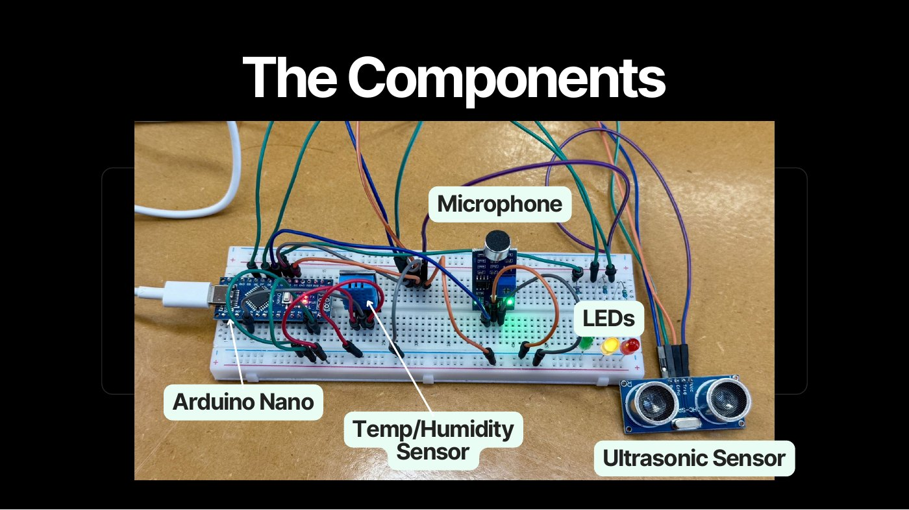

# Hardware



The make-a-thon prototype was built on a breadboard around an **Arduino Nano**.
The firmware also runs unchanged on an **Arduino Uno**: both are ATmega328P
boards with the same pin names.

## Bill of materials

| Qty | Part | Purpose |
|----:|------|---------|
| 1 | Arduino Nano (or Uno) | Microcontroller: all sensor logic and the ESRS run on the board |
| 1 | HC-SR04 ultrasonic sensor | Measures screen-to-user distance (laptop-mounted, facing the user) |
| 1 | DHT11 temperature & humidity sensor *(optional)* | Dry-air multiplier |
| 1 | Microphone sound-sensor module, analog out *(optional)* | Loud-room multiplier |
| 3 | 5 mm LEDs: green, amber (yellow), red | Safe / warning / take a break (red blinks when < 30 cm) |
| 1 | Small 3–5 V vibration motor + NPN transistor (e.g. 2N2222), 1 kΩ base resistor, 1N4148 flyback diode *(optional)* | Haptic alert |
| 3 | 220 Ω resistors | LED current limiting |
| 1 | USB power bank | Fully offline, portable operation |
| 1 | 3D-printed clip-on housing | Holds the ultrasonic sensor on top of the laptop lid ([CAD render](images/cad-design.jpg)) |
| – | Breadboard, jumper wires | |

## Wiring

> The original breadboard pin map wasn't recorded. These are the pins used by
> [`firmware/EyeMaxxer/config.h`](../firmware/EyeMaxxer/config.h). Change them
> there if your wiring is different.

| Component | Pin | Arduino |
|-----------|-----|---------|
| HC-SR04 | VCC / GND | 5V / GND |
| HC-SR04 | TRIG / ECHO | D9 / D10 |
| DHT11 | VCC / GND | 5V / GND |
| DHT11 | DATA | D2 (10 kΩ pull-up to 5V if using a bare sensor) |
| Microphone module | VCC / GND | 5V / GND |
| Microphone module | AO | A0 |
| Green LED | anode → 220 Ω | D3 |
| Amber LED | anode → 220 Ω | D5 |
| Red LED | anode → 220 Ω | D6 |
| All LEDs | cathode | GND |
| Vibration motor | via NPN transistor (base ← 1 kΩ ← pin) | D8 |

```
                  ┌───────────────────────┐
  HC-SR04 TRIG ───┤ D9                 5V ├─── VCC (all sensors)
  HC-SR04 ECHO ───┤ D10               GND ├─── GND (sensors + LED cathodes)
    DHT11 DATA ───┤ D2                    │
     Mic AO ──────┤ A0    Arduino Nano    │
  Green LED ◄─────┤ D3 ─[220Ω]            │
  Amber LED ◄─────┤ D5 ─[220Ω]            │
  Red   LED ◄─────┤ D6 ─[220Ω]            │
  Vib. motor ◄────┤ D8 ─[1kΩ]─ NPN    USB ├─── laptop (MATLAB GUI) or power bank
                  └───────────────────────┘
```

## Calibration tips

- **Ultrasonic:** mount it on the top edge of the lid, angled slightly down at
  the user's face and chest. A 5-sample rolling median rejects one-off echoes.
  If there is no echo (nobody there), the reading is 400 cm, which is the recovery zone.
- **Microphone:** "loud" means the loudest 20 ms window in a tick has a
  peak-to-peak amplitude of at least `MIC_LOUD_P2P` ADC counts (300 by default).
  Open the Serial Monitor at 9600 baud and adjust `MIC_LOUD_P2P` or the module's
  trim pot until talking nearby gives `SOUND:1` and a quiet room gives `SOUND:0`.
- **DHT11:** read once per tick. It reports `HUM:0` until the first valid reading,
  and 0 never counts as dry.
- **Optional parts:** set `USE_DHT 0` or `USE_MIC 0` in `config.h` if a sensor
  isn't fitted. With only the ultrasonic sensor and the LEDs, everything still
  works; there just aren't any multipliers.
