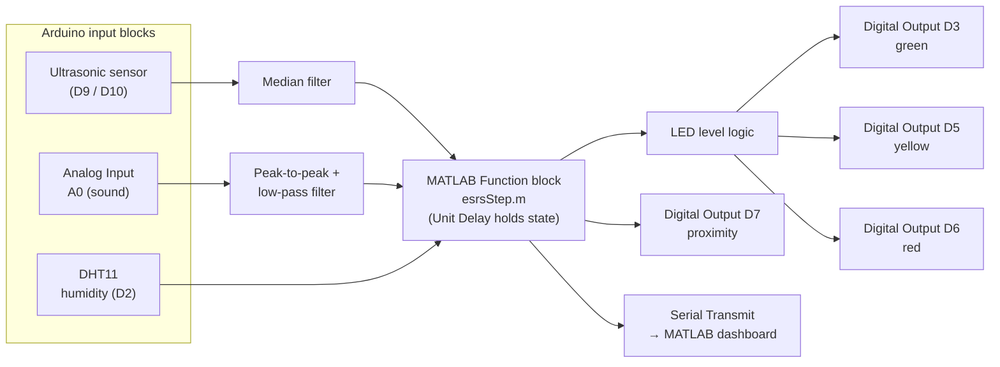

# Simulink model

The first stage of EyeMaxxer's MATLAB integration was to design the embedded
control logic in **Simulink** and deploy it to an **Arduino Nano** with the
*Simulink Support Package for Arduino Hardware*.

## Model structure

## Rebuilding the model

1. Install the **Simulink Support Package for Arduino Hardware** from the Add-On Explorer.
2. Create a new model and set *Hardware Implementation → Hardware board* to
   **Arduino Nano 3.0** (or **Arduino Uno**). Use a fixed-step solver with a
   step size of **0.1 s**.
3. Add a **MATLAB Function** block that calls
   [`esrsStep`](../matlab/esrsStep.m). The function only uses scalar maths and
   structs, so it can be code-generated as-is. Keep `state` in a
   **Unit Delay** (or a `persistent` variable) and take the parameters from
   [`esrsParams`](../matlab/esrsParams.m).
4. Wire the Arduino input/output blocks to the pins listed in
   [`docs/hardware.md`](../docs/hardware.md).
5. Use **Monitor & Tune** to tweak thresholds live, or **Build, Deploy & Start**
   to run it stand-alone.

> Put the original `.slx` model from the make-a-thon in this folder.
> The hand-written C++ firmware in [`firmware/`](../firmware) implements the
> same logic and is the easiest way to flash a board without Simulink.
