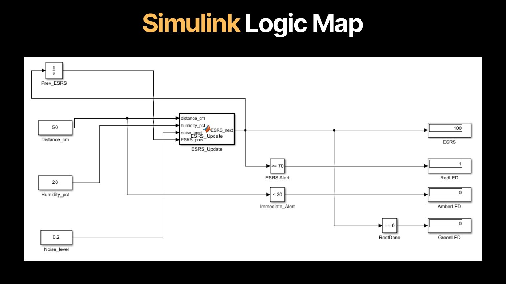

# Simulink model

[`simulink_eyestrain.slx`](simulink_eyestrain.slx) is the team's original Simulink model (saved in MATLAB R2025b).
It was the first stage of EyeMaxxer's MATLAB integration: designing the embedded
control logic before it went onto the Arduino Nano.

## Blocks

| Block | Type | Role |
|-------|------|------|
| `Distance_cm`, `Humidity_pct`, `Noise_level` | Constant | Sensor inputs. Set them to try different conditions, or swap them for Arduino input blocks on hardware |
| `ESRS_Update` | MATLAB Function | Computes `ESRS_next` from the distance zone rate and the dry / noisy multipliers |
| `Prev_ESRS` | Unit Delay (1/z) | Feeds `ESRS_next` back in as `ESRS_prev`, so the score accumulates over time |
| `ESRS Alert` | Compare to constant `>= 70` | Red LED |
| `Immediate_Alert` | Compare to constant `< 30` | Amber LED (uses the distance directly) |
| `RestDone` | Compare to constant `== 0` | Green LED |
| `ESRS`, `RedLED`, `AmberLED`, `GreenLED` | Display | Outputs |

The `ESRS_Update` code is reproduced in [`matlab/esrsStep.m`](../matlab/esrsStep.m)
(with `dt` and the constants passed in). The live Arduino version in
[`firmware/EyeMaxxer/esrs.h`](../firmware/EyeMaxxer/esrs.h) keeps the same
structure on a faster 0–1000 per-tick scale. Details are in
[`docs/esrs-algorithm.md`](../docs/esrs-algorithm.md).

## Running it

1. Open `simulink_eyestrain.slx` in MATLAB R2025b or newer.
2. Change the three Constant blocks (e.g. `Distance_cm = 50`, `Humidity_pct = 28`)
   and press **Run** to watch the ESRS and LED displays update.
3. To deploy it to a board, install the **Simulink Support Package for Arduino Hardware**.
   Then set *Hardware board* to **Arduino Nano 3.0**, swap the Constants for
   Ultrasonic / Analog Input / DHT blocks and the Displays for Digital Output
   blocks, and use **Build, Deploy & Start**.
